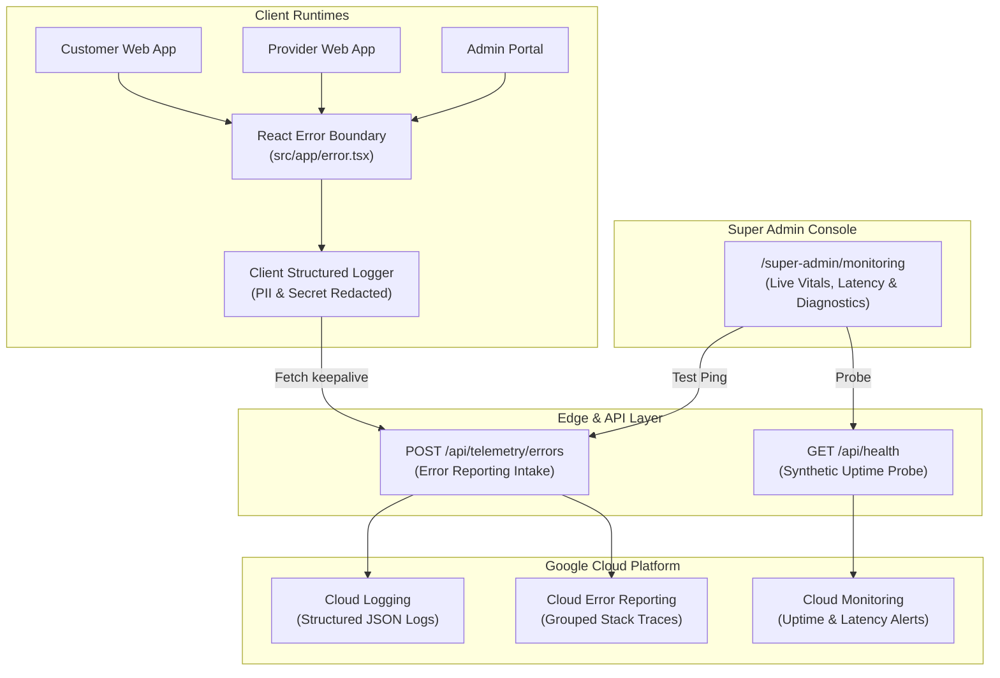

# GhorBondhu (ঘরবন্ধু) - Monitoring, Health Checks & Observability Guide

> **Version:** 1.0.0  
> **Target Cloud:** Google Cloud Platform (GCP) & Firebase  
> **Primary Region:** `asia-southeast1` (Singapore / South-East Asia)  
> **Status:** Production Ready  

---

## 1. Observability Architecture & Philosophy

GhorBondhu operates under a **Zero-Trust & Proactive Observability Architecture**. Telemetry is treated as a first-class operational asset:



### Key Principles:
1. **Zero Data Leakage:** Automatic PII and credential redaction (passwords, JWT tokens, API keys, NIDs, CVVs, card numbers).
2. **Correlation Tracing:** Every error context carries an optional `correlationId` or `traceId` linking browser client sessions to backend Firestore transactions and Cloud Functions triggers.
3. **Multi-Horizon Defense:** Combines synthetic edge probing (proactive), React error boundaries (reactive user protection), and automated Cloud Error Reporting ingestion.

---

## 2. Telemetry & Monitoring Endpoints

### 2.1 Synthetic Health Prober: `GET /api/health`
Designed for external monitoring engines (e.g. Google Cloud Uptime Checks, Better Stack, Pingdom).

- **Route:** `src/app/api/health/route.ts`
- **Cache Strategy:** `no-store, no-cache, must-revalidate`
- **Response Format:**
```json
{
  "status": "healthy",
  "service": "GhorBondhu Web Platform",
  "uptimeSeconds": 14205,
  "timestamp": "2026-10-07T10:30:00.000Z",
  "environment": "production",
  "version": "0.1.0",
  "region": "asia-southeast1",
  "checks": {
    "webRuntime": "ok",
    "clientConfiguration": "active"
  },
  "latencyMs": 1
}
```

### 2.2 Client Error Telemetry Intake: `POST /api/telemetry/errors`
Receives unhandled client-side exceptions from React error boundaries and converts them into standardized Google Cloud Error Reporting events.

- **Route:** `src/app/api/telemetry/errors/route.ts`
- **GCP ReportedErrorEvent Format:**
```json
{
  "@type": "type.googleapis.com/google.devtools.clouderrorreporting.v1beta1.ReportedErrorEvent",
  "message": "Gateway connection timed out",
  "serviceContext": {
    "service": "ghorbondhu-web-client",
    "version": "0.1.0"
  },
  "context": {
    "httpRequest": {
      "userAgent": "Mozilla/5.0 ...",
      "remoteIp": "203.0.113.195"
    },
    "user": "usr_98124",
    "reportLocation": {
      "filePath": "client-stack"
    }
  },
  "timestamp": "2026-10-07T10:30:01.000Z"
}
```

---

## 3. Structured Logging & PII Sanitizer

Implemented in `src/lib/monitoring/logger.ts`, the logger outputs structured JSON entries compatible with Google Cloud Logging.

### 3.1 PII & Secret Redaction Patterns
Any key matching the following regex expressions in `metadata` or context is replaced with `"[REDACTED]"`:
- `/password/i`
- `/token/i`
- `/secret/i`
- `/authorization/i`
- `/cookie/i`
- `/api[_-]?key/i`
- `/nid/i`
- `/card[_-]?number/i`
- `/cvv/i`

### 3.2 Logger Usage Example
```typescript
import { logger } from "@/lib/monitoring/logger";

// Standard operational info
logger.info("Payment confirmed via SSLCommerz IPN", {
  userId: "cust_123",
  resourceType: "PAYMENT",
  resourceId: "pay_456",
  metadata: {
    amountBDT: 1500,
    gateway: "sslcommerz",
  },
});

// Critical error reporting
logger.error("Failed to dispatch telecom OTP", {
  userId: "prov_789",
  correlationId: "trace-9182a",
  error: new Error("Greenweb SMS socket timeout"),
});
```

---

## 4. Google Cloud Logging Query Cookbook

Copy and paste these queries into the **Google Cloud Console > Logs Explorer**:

### 4.1 All High Severity Errors Across Services
```sql
resource.type="cloud_run_revision" OR resource.type="cloud_function"
severity >= ERROR
```

### 4.2 Telecom SMS Gateway Failures
```sql
jsonPayload.service="ghorbondhu-telecom" OR jsonPayload.message=~"SMS"
jsonPayload.level="ERROR" OR severity >= ERROR
```

### 4.3 Financial Discrepancies & Payment Webhook Issues
```sql
jsonPayload.resourceType="PAYMENT" OR jsonPayload.category="PAYMENT"
jsonPayload.level="ERROR" OR jsonPayload.message=~"SSLCommerz|bKash|Nagad"
```

### 4.4 Rate Limiter Breaches & Denial of Service Triggers
```sql
jsonPayload.message=~"Rate limit exceeded" OR jsonPayload.code="resource-exhausted"
```

---

## 5. Telecom & Financial SLA Matrix

| Component | Target SLA | Monitoring Method | Failure Mitigation |
| :--- | :--- | :--- | :--- |
| **Web Edge Runtime** | 99.95% | `/api/health` 1-minute probe | Multi-zone failover |
| **Cloud Functions (V2)** | 99.99% | Cloud Monitoring metrics | Auto-concurrency & warm instances |
| **Cloud Firestore** | 99.999% | Multi-region replication | Client offline persistence & memory cache |
| **Bulk SMS (Greenweb)** | 99.0% | Audit collection `/sms_logs` | Secondary operator retry & in-app push fallback |
| **SSLCommerz / bKash** | 99.5% | IPN validation audit logs | 72-hour automated transaction reconciliation |

---

## 6. Incident Response & On-Call Playbook

### 6.1 Severity Definitions

- **SEV-1 (Platform Down):** Core booking or checkout is broken; users cannot request or pay for services.
  - *Response Time:* < 15 minutes.
  - *Notification:* PagerDuty / Telegram Critical Bot / SMS to Lead Engineer.
  - *Action:* Enable Maintenance Mode via `/super-admin/settings` if database integrity is at risk.

- **SEV-2 (Degraded Component):** Telecom SMS OTP delayed (> 3 minutes); provider auto-dispatch failing.
  - *Response Time:* < 1 hour.
  - *Action:* Switch to manual admin dispatch in `/super-admin`; toggle fallback SMS gateway.

- **SEV-3 (Non-Critical Bug):** UI glitch, minor translation error, isolated user permission issue.
  - *Response Time:* Next business day.

### 6.2 Incident Post-Mortem Template
Every SEV-1 or SEV-2 event requires a blameless post-mortem document:
1. **Summary:** Brief description of duration and user impact.
2. **Timeline:** UTC and BST timestamps from detection to resolution.
3. **Root Cause:** In-depth technical breakdown.
4. **Trigger:** What event caused the issue to manifest.
5. **Detection:** How was the failure discovered (automated alert vs. customer report).
6. **Action Items:** Preventive code, rule, or architectural modifications with assigned GitHub issue tickets.
